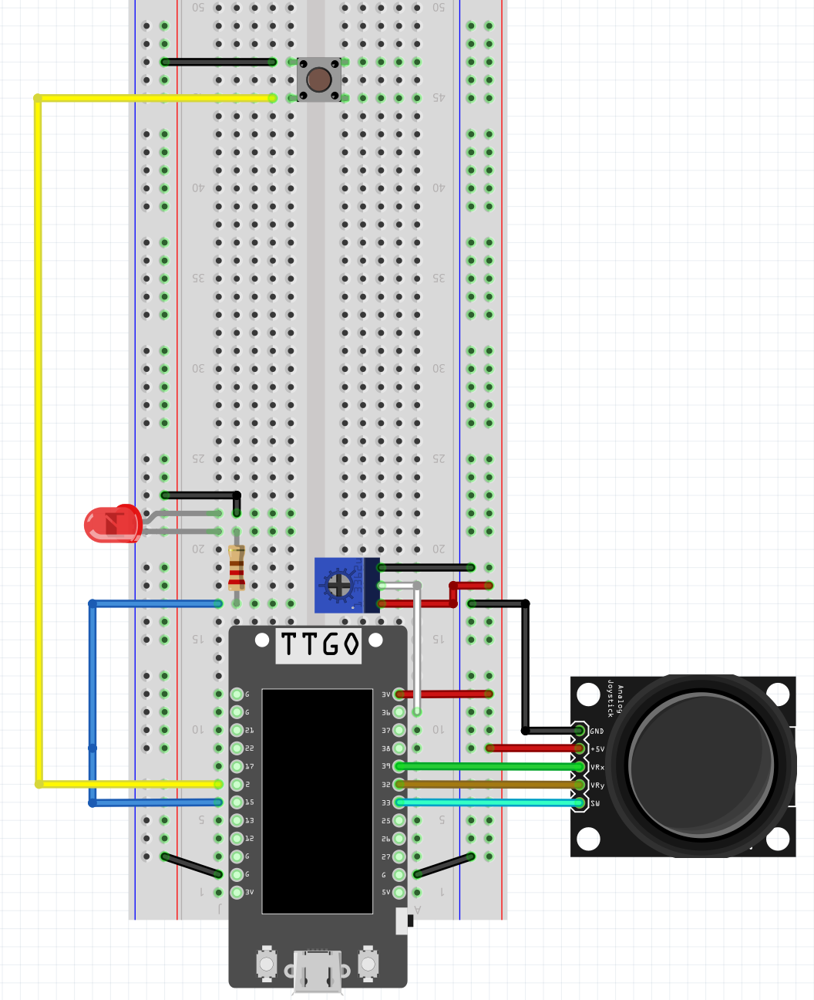
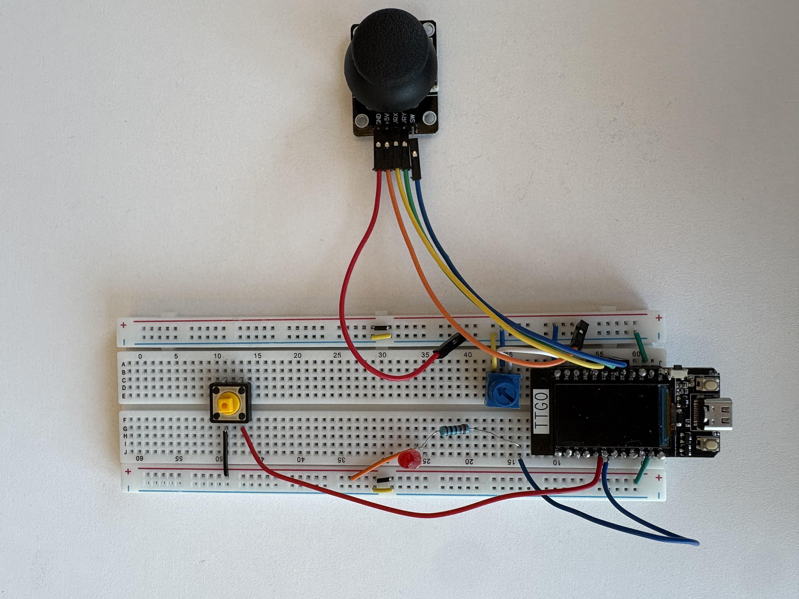
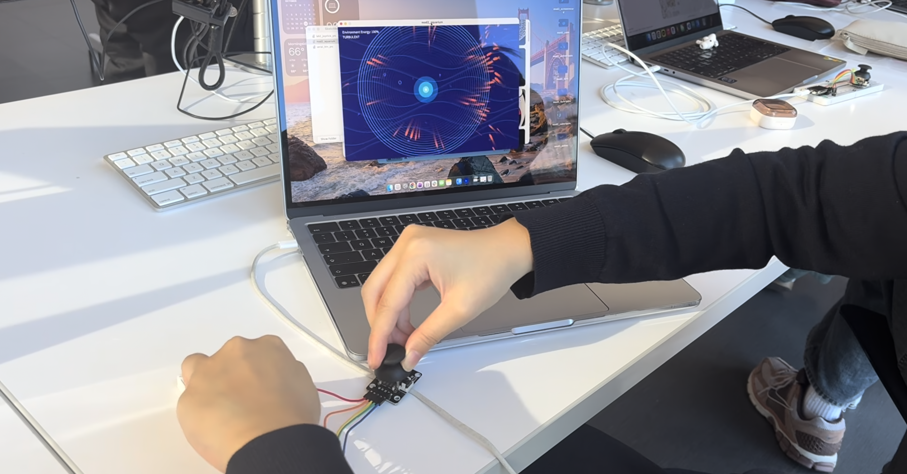

# Interactive Digital Aquarium

An interactive generative aquarium controlled using an ESP32, joystick, potentiometer, and pushbutton.

The project explores the relationship between **control and emergence**. The user can influence the ecosystem, but the fish retain their own wandering and current-driven behavior.


## About the Project

The aquarium is controlled through three physical inputs:

- **Joystick:** moves a glowing attractor that the fish chase
- **Potentiometer:** transitions the water between Calm, Active, and Turbulent states
- **Button:** creates an expanding ripple that disperses the fish

As the water becomes more turbulent, the fish move faster, schooling becomes less organized, currents become stronger, and the color palette shifts toward warmer colors.

The fish still pursue the attractor in all three environmental states, but their paths become increasingly chaotic as turbulence increases.

## Hardware

- LILYGO / TTGO T-Display ESP32
- Breadboard
- Joystick module
- Potentiometer
- Pushbutton
- Jumper wires
- USB cable

## Circuit



### Joystick

| Joystick Pin | ESP32 Connection |
| --- | --- |
| GND | GND |
| +5V | 3.3V |
| VRX | GPIO 39 |
| VRY | GPIO 32 |
| SW | GPIO 33 |

The joystick module's power pin is powered from the ESP32's **3.3V supply** in this project.

### Potentiometer

| Potentiometer Pin | ESP32 Connection |
| --- | --- |
| Outer pin | 3.3V |
| Middle / wiper | GPIO 36 |
| Outer pin | GND |

The two outer potentiometer pins may be swapped. Doing so only reverses whether the sensor value increases clockwise or counterclockwise.

### Pushbutton

| Button Connection | ESP32 Connection |
| --- | --- |
| One side | GPIO 2 |
| Other side | GND |

The Arduino sketch uses `INPUT_PULLUP`, so the button values are:

- `1` = not pressed
- `0` = pressed

## Software

The project uses two programs:

1. An **Arduino sketch** running on the ESP32
2. A **Processing sketch** running on the laptop

### Arduino

The ESP32 continuously reads:

- Joystick X position
- Joystick Y position
- Potentiometer value
- Pushbutton state

It sends the values to the laptop over Serial as comma-separated data.

The format is:

```text
joystickX,joystickY,potentiometer,button
```

Example:

```text
2048,1987,3100,1
```

### Processing

The Processing sketch reads the Serial data and generates the aquarium in real time.

The visualization includes:

- Joystick-controlled attraction
- Fish schooling behavior
- Separation, alignment, and cohesion forces
- Water currents
- Bubbles
- Depth variation
- Motion trails
- Calm, Active, and Turbulent environmental states
- Changing fish colors and speeds
- Expanding button-triggered ripples
- Temporary fish dispersion after ripple impacts

## Controls

| Physical Input | Effect |
| --- | --- |
| Joystick | Moves the glowing attractor |
| Potentiometer | Controls Calm → Active → Turbulent water |
| Pushbutton | Creates a ripple that disperses the fish |

## Running the Project

### 1. Build the Circuit

Wire the ESP32, joystick, potentiometer, and pushbutton according to the Fritzing diagram above.

### 2. Upload the Arduino Sketch

Open:

```text
arduino/sensor_serial/mod2_sensorserial.ino
```

in Arduino IDE.

Select:

- **Board:** `ESP32 Dev Module`
- **Port:** the serial port corresponding to your ESP32
- **Upload Speed:** `115200`

Upload the sketch.

### 3. Confirm Serial Data

Open Arduino's Serial Monitor at `115200` baud.

You should see lines similar to:

```text
2048,2015,3020,1
2055,2019,3020,1
3110,2022,3020,0
```

Move the joystick, turn the potentiometer, and press the button to confirm that the values change.

### 4. Close the Serial Monitor

Close Arduino's Serial Monitor before starting Processing.

Only one program can use the ESP32's serial port at a time.

### 5. Open the Processing Sketch

Open:

```text
processing/digital_aquarium/mod2_aquarium.pde
```

in Processing.

### 6. Check the Serial Port

The Processing sketch contains a line similar to:

```java
myPort = new Serial(
  this,
  "/dev/cu.usbserial-5C491317361",
  115200
);
```

Your serial port may have a different name.

If necessary, use:

```java
printArray(Serial.list());
```

to see the available serial ports and replace the port name in the sketch.

### 7. Run the Processing Sketch

Run the Processing program and interact with the aquarium using the three physical controls.

## Interaction Design

### Calm

At low potentiometer values:

- Fish move slowly
- Schooling is more organized
- Currents are subtle
- Colors remain mostly blue and cyan
- Ripples disperse the fish, but the effect is relatively gentle

### Active

At medium potentiometer values:

- Fish move faster
- Currents become stronger
- Schooling becomes less regular
- Colors begin shifting warmer
- Ripples cause stronger dispersion

### Turbulent

At high potentiometer values:

- Fish move quickly
- Water currents become much stronger
- Fish wander more independently
- Colors shift toward coral and orange
- Ripples strongly scatter the school

Even in the Turbulent state, the fish continue to pursue the joystick-controlled attractor. Turbulence affects the paths they take rather than removing their attraction to the target.

## Project Structure

```text
module2_ces/
│
├── README.md
│
├── arduino/
│   └── sensor_serial/
│       └── mod2_sensorserial.ino
│
├── processing/
│   └── digital_aquarium/
│       └── mod2_aquarium.pde
│
└── media/
    ├── demo.gif
    ├── fritzing-diagram.png
    ├── breadboard.jpg
    └── final-setup.jpg
```

## Documentation

### Demo


### Breadboard Setup



### Final Setup



## More Information

For more information about the artistic vision, design process, technical implementation, debugging, and AI support used during development, see the accompanying blog post: 
https://app.notion.com/p/Module-2-4a34a92f475b83b6ab6b8109dd45c91b?source=copy_link
